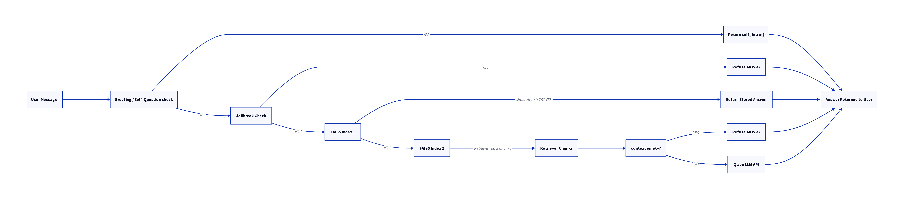

# 🧙 Pensieve — Harry Potter Chatbot

> A retrieval-augmented chatbot that answers questions strictly from a Harry Potter knowledge base, powered by dual FAISS indexing and the Qwen LLM.


|                |                                                   |
| -------------- | ------------------------------------------------- |
| **University** | Bahçeşehir University                             |
| **Course**     | COP4921 – Applied Large Language Models (2025/26) |
| **Professor**  | Ahmet Tugrul BAYRAK                               |
| **Contributors** | Abdullah Hani Abdellatif Al-Shobaki; Abdulah M. M. Abbas |


---

## Features

- **Grounded answers only** — the bot refuses to answer anything not supported by the knowledge base
- **Dual FAISS retrieval** — fast direct-answer lookup (no API call) + semantic context retrieval for the LLM
- **Jailbreak & injection protection** — 17 regex patterns + system prompt enforce strict boundaries
- **Conversation memory** — remembers the last 3 exchanges for follow-up questions
- **Format manipulation resistance** — ignores instructions like "answer in 5 words"
- **Harry Potter themed UI** — dark gold chat interface served by Flask

---

## How It Works

```
User message
     │
     ▼
[Greeting / self-question check] ──YES──► Return self-introduction (no API call)
     │ NO
     ▼
[Jailbreak check] ──YES──► "I cannot answer that.."
     │ NO
     ▼
[FAISS Index 1 — questions only]
 similarity ≥ 0.75? ──YES──► Return stored answer (no API call)
     │ NO
     ▼
[FAISS Index 2 — full knowledge base]
 Retrieve top 5 most relevant chunks
 context empty? ──YES──► "I cannot answer that.."
     │ NO
     ▼
[Qwen LLM API]
 system prompt + context + history + user message
     │
     ▼
 Answer returned to user
```



**Two FAISS indexes:**


| Index                   | Content        | Purpose                                         |
| ----------------------- | -------------- | ----------------------------------------------- |
| `faiss_questions.index` | Questions only | Fast exact-match lookup, skips API if confident |
| `faiss_fulldata.index`  | All content    | Semantic context retrieval for the LLM          |


Both use TF-IDF vectorization (bigrams) with L2-normalized cosine similarity.

---

## Project Structure

```
harry_potter_bot/
├── data/
│   ├── harry_potter_data_02.xlsx   ← Knowledge base (Q&A pairs + raw info)
│   ├── questions.json              ← Question strings (built by build_index.py)
│   ├── answers.json                ← Answer strings  (built by build_index.py)
│   └── all_texts.json              ← All text chunks (built by build_index.py)
├── retrieval/
│   ├── faiss_questions.index       ← FAISS index 1 (questions only)
│   ├── faiss_fulldata.index        ← FAISS index 2 (all content)
│   ├── vectorizer_questions.skops  ← TF-IDF vectorizer for index 1
│   └── vectorizer_fulldata.skops   ← TF-IDF vectorizer for index 2
├── templates/
│   └── index.html                  ← Chat UI (single-page)
├── report/
│   └── Pensieve_Report.pdf         ← Project report
│   └── pensieve_flow.png           ← Flow Diagram
├── presentation/
│   └── Pensieve_Presentation       ← Project presentation
├── app.py                          ← Flask web server
├── chatbot.py                      ← Core chatbot logic
├── build_index.py                  ← One-time index builder
├── requirements.txt
├── .env                            ← API keys (not committed)
└── .env.example                    ← Template for .env
```

---

## Setup

### 1. Install dependencies

```bash
pip install -r requirements.txt
```

### 2. Configure environment variables

```bash
cp .env.example .env
```

Edit `.env` and fill in your Qwen API key:

```
QWEN_API_KEY=your_key_here
FLASK_SECRET_KEY=any_long_random_string
```

### 3. Build FAISS indexes (run once, or after updating the data)

```bash
python build_index.py
```

Expected output:

```
Loading data...
Total rows: XX | QA pairs: XX | Raw info: XX

Building FAISS index 1 (questions only)...
  Indexed XX questions

Building FAISS index 2 (full data)...
  Indexed XX chunks

All indexes built successfully!
```

### 4. Start the app

```bash
python app.py
```

### 5. Open in browser

```
http://localhost:5000
```

---

## Configuration

All configuration is in `chatbot.py` constants:


| Constant               | Default     | Description                                           |
| ---------------------- | ----------- | ----------------------------------------------------- |
| `SIMILARITY_THRESHOLD` | `0.75`      | Minimum cosine similarity for direct answer (Index 1) |
| `TOP_N_CHUNKS`         | `5`         | Number of context chunks retrieved from Index 2       |
| `MAX_HISTORY`          | `6`         | Messages kept in conversation history (3 turns)       |
| `MODEL`                | `qwen-plus` | Qwen model used for API calls                         |


---

## Requirements Coverage


| #   | Requirement                                        | Implementation                                |
| --- | -------------------------------------------------- | --------------------------------------------- |
| 1   | Only answer questions related to data              | FAISS retrieval + system prompt rule #1       |
| 2   | Say "I cannot answer that.." if answer not in data | System prompt rule #1 & #6                    |
| 3   | Answer greetings and self-questions                | `is_greeting()` / `is_self_question()` shortcut before FAISS or API |
| 4   | Resilient to jailbreak / injection                 | 17 regex patterns + system prompt rules #3–#4 |
| 5   | Remember last N questions                          | `MAX_HISTORY=6` passed with every API call    |
| 6   | Ignore format manipulation                         | Regex + system prompt rule #5                 |
| 7   | Smart FAISS chunking                               | TF-IDF bigrams, top 5 chunks from Index 2     |
| 8   | Two FAISS models                                   | Index 1 (direct), Index 2 (context for LLM)   |
| 9   | Chat interface                                     | Flask + Harry Potter themed HTML/JS UI        |
| 10  | Report                                             | `report/report.pdf`                           |


---

## Troubleshooting

`**ModuleNotFoundError: No module named 'faiss'**`

```bash
pip install faiss-cpu
```

`**FileNotFoundError: retrieval/...**`
You need to build the indexes first:

```bash
python build_index.py
```

**Bot always says "I cannot answer that.."**

- Check your `QWEN_API_KEY` in `.env` is correct
- Verify the data file exists at `data/harry_potter_data_02.xlsx`
- Try lowering `SIMILARITY_THRESHOLD` in `chatbot.py` if direct answers aren't matching

**Sessions reset on server restart**
Make sure `FLASK_SECRET_KEY` is set in `.env` (not empty).

---

## Tech Stack

Python · Flask · FAISS · scikit-learn · Qwen (Alibaba DashScope) · HTML/CSS/JS
